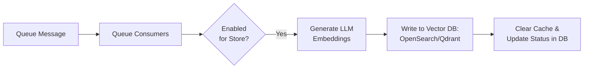

# Module Context: MageSetu_SemanticSearch

`MageSetu_SemanticSearch` is a Magento 2 module that implements an AI-powered **Semantic Search** system. It runs in parallel with Magento's native catalog search, using vector embeddings to find relevant products based on natural language queries.

---

## 1. System Pipelines & Architecture

The module's architecture is structured around three key pipelines: catalog lifecycle indexing, background queue execution, and storefront search query resolution.

### A. Catalog Lifecycle & Indexing Flow
When products are updated, deleted, or updated in bulk, events trigger observers and plugins to queue indexing. The indexer computes content hashes and writes status records to the database.

### B. Asynchronous Queue Processing
The embedding generation is decoupled from the web request lifecycle. Queue consumers pick up payloads asynchronously, generate vectors using AI model clients (OpenAI or Ollama), save them to vector storage, and finalize status records.

### C. Storefront Search & Retrieval
When a customer searches using a natural language query, the system validates the input through guardrails, converts it into a search vector, queries the vector database for nearest matches, and generates a personalized shopper message explaining the recommendations.

---

## 2. Directory Map & Core Files

- `/etc/` — Central Magento configuration (DI preferences, routing, events, indexer definitions, queue topology, system XML config UI).
- `/Model/` — Core business logic, source/config models, exception handling, and cache services.
- `/Setup/` — Declarative database schema and EAV attribute data patches.
- `/Block/` & `/view/` — Storefront PHTML templates, CSS styles, Knockout components, and admin grid components.
- `/docs/` — Structured technical documentation (Markdown).

---

## 3. Documentation Reference Guide

The complete details of the architecture, specifications, and code files are documented in the `docs/` directory.

### Quick Start
- **[Main Documentation Index](docs/index.md)** — Hub linking to all documents in the knowledge base.
- **[System Configuration & Defaults](docs/configurations/adminhtml/system-config-and-defaults.md)** — Core settings, option groups, and credentials settings.
- **[CLI Console Commands](docs/features/semantic-search/console-commands.md)** — Maintenance commands for orphan removal and collection prefix inspections.

### Key Pipelines
- **[Indexer Flow](docs/features/semantic-search/indexer-flow.md)** — Details full/partial reindexing and changelog subscriptions.
- **[Queue-Based Processing](docs/features/semantic-search/queue-consumers.md)** — Asynchronous queue configuration, consumer handlers, and [Queue Publishers](docs/features/semantic-search/queue-publishers.md).
- **[Vector Storage Overview](docs/features/semantic-search/vector-storage-overview.md)** — Pluggable storage pool selecting between OpenSearch and Qdrant.
  - **[OpenSearch Storage Adapter](docs/features/semantic-search/vector-storage-opensearch.md)** — native PHP kNN mappings and writes.
  - **[Qdrant Storage Adapter](docs/features/semantic-search/vector-storage-qdrant.md)** — REST API operations.
- **[Frontend Search Experience](docs/features/semantic-search/frontend-search-experience.md)** — Storefront MVC controllers, Knockout layouts, and step-by-step query flows.

### Services & Persistence
- **[Core Services Index](docs/features/semantic-search/services/index.md)** — References for validator, searcher, generator, personalized messaging, and cleaner services.
- **[Product Table Schema](docs/database-schema/magesetu-semantic-search-product-table.md)** — Declarative schema tracking content hashes, status values, and failures.
- **[AI Context Attribute Data Patch](docs/database-schema/ai-search-context-product-attribute.md)** — EAV database patch setting up store-scoped AI copy fields on catalog products.
- **[Vector Storage Exceptions](docs/utilities/vector-storage-exceptions.md)** — Markers separating operations failures from selection/registry failures.
