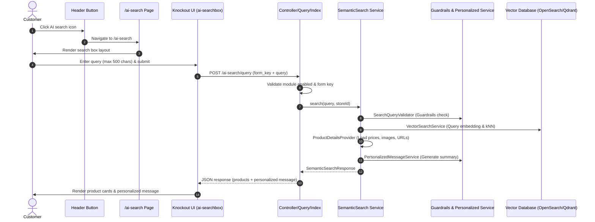

# Storefront AI Search Experience

The storefront AI search experience provides a natural-language product discovery interface where customers can type queries or prompts, receive LLM-validated vector search results, and view an AI-generated personalized recommendation summary.

## Overview

The storefront flow consists of:
1. **Header Entry Point**: A dedicated AI search button in the storefront header.
2. **Dedicated Landing Page**: An isolated single-column search view with clean styling.
3. **Interactive Knockout UI**: A dynamic input box with character limit counters, sparkle animations, loading states, and instant feedback.
4. **AJAX Search Controller**: A backend POST endpoint that runs guardrails validation, vector search, product enrichment, and personalized message generation.

---

## Architecture & Data Flow

---

## Route & Layout Configuration

### 1. Route Registration

Defined in [etc/frontend/routes.xml](../../../etc/frontend/routes.xml):
- **Router ID:** `standard`
- **Front Name:** `ai-search`
- **Module:** `MageSetu_SemanticSearch`

Available endpoints:
- `GET /ai-search` &rarr; `MageSetu\SemanticSearch\Controller\Index\Index`
- `POST /ai-search/query` &rarr; `MageSetu\SemanticSearch\Controller\Query\Index`

### 2. Header Button

Configured in [view/frontend/layout/default.xml](../../../view/frontend/layout/default.xml):
- Injected into the `header-wrapper` container before `topSearch`.
- Rendered via template `view/frontend/templates/ai-search-button.phtml`.
- Controlled by config flag `magesetu_semantic_search/general/enabled`. When disabled, the button is not rendered.

### 3. Search Landing Page

Configured in [view/frontend/layout/magesetu_semantic_search_index_index.xml](../../../view/frontend/layout/magesetu_semantic_search_index_index.xml):
- Page layout: `1column`.
- Suppresses default header search and main title to provide a focused AI search experience.
- Mounts `MageSetu\SemanticSearch\Block\AiSearch\Main` in the `content` container.
- Declares the Knockout JS layout hierarchy under `ai-searchbox`.

---

## Controllers

### 1. Page Controller: `Controller/Index/Index.php`
- Implements `HttpGetActionInterface`.
- Checks if semantic search is enabled for the store via `ConfigInterface::isModuleEnabled()`.
- If disabled, forwards to `defaultNoRoute` (404).
- If enabled, returns the `1column` result page.

### 2. Search API Controller: `Controller/Query/Index.php`
- Implements `HttpPostActionInterface`.
- Validates the Magento CSRF form key (`FormKeyValidator`).
- Validates query constraints:
  - Query must not be empty.
  - Query must not exceed 500 characters.
- Delegates search execution to `SemanticSearchInterface::search($query)`.
- Returns structured JSON:
  - `success`: boolean
  - `query`: sanitized input query
  - `result.message`: personalized AI message (or guardrails rejection message)
  - `result.products`: array of matched products with `id`, `name`, `price`, `image_url`, and `link`.

---

## UI Components & Knockout Templates

- **`ai-searchbox.js`**: Top-level UI component handling input state, character limits, submission handling, and loader display.
- **`products.js`**: Child component displaying the personalized AI message and rendering the responsive grid of product cards.
- **`ai-searchbox-model.js`**: Observable state container managing search results, messages, errors, and loading flags.
- **`action/ai-search.js`**: AJAX action handler communicating with the `/ai-search/query` endpoint.
- **`templates/ai-searchbox.html`**: Form, input textarea, character counter, SVG sparkle icons, and error handling.
- **`templates/ai-searchbox/products.html`**: Personalized recommendation banner and product card grid.
